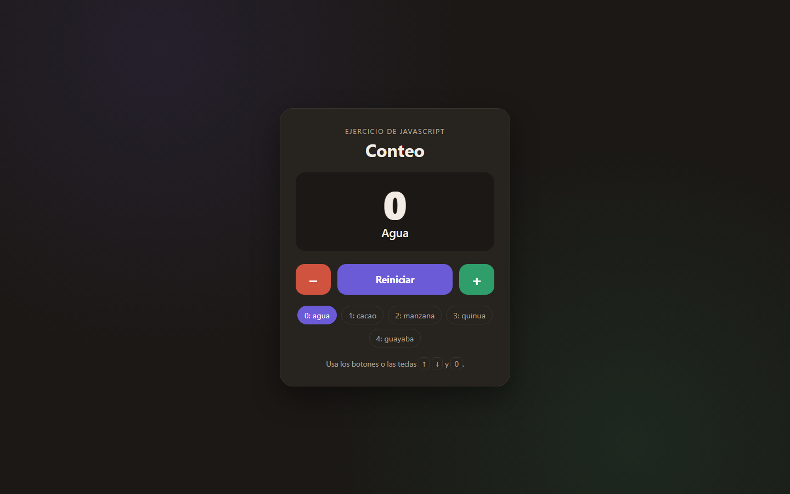

# Contador en JavaScript

Pequeño ejercicio de manipulación del DOM: un contador que aumenta, disminuye o se reinicia, y muestra la palabra de una lista que corresponde a la posición actual (o "No existe" si el número queda fuera de la lista).

**Demo:** https://alejo234506.github.io/js/

## Funcionalidades

- Botones para aumentar, disminuir y reiniciar.
- Atajos de teclado: <kbd>↑</kbd> / <kbd>+</kbd>, <kbd>↓</kbd> / <kbd>-</kbd> y <kbd>0</kbd> / <kbd>Esc</kbd>.
- Color del número según sea positivo o negativo y resaltado de la palabra activa.
- Diseño responsive, modo oscuro automático y anuncio del valor para lectores de pantalla (`aria-live`).

## Cómo ejecutarlo

No necesita instalación: abre `index.html` en el navegador.

## Archivos

| Archivo | Descripción |
| --- | --- |
| `index.html` | Estructura de la página |
| `style.css` | Estilos |
| `conteo.js` | Lógica del contador |
